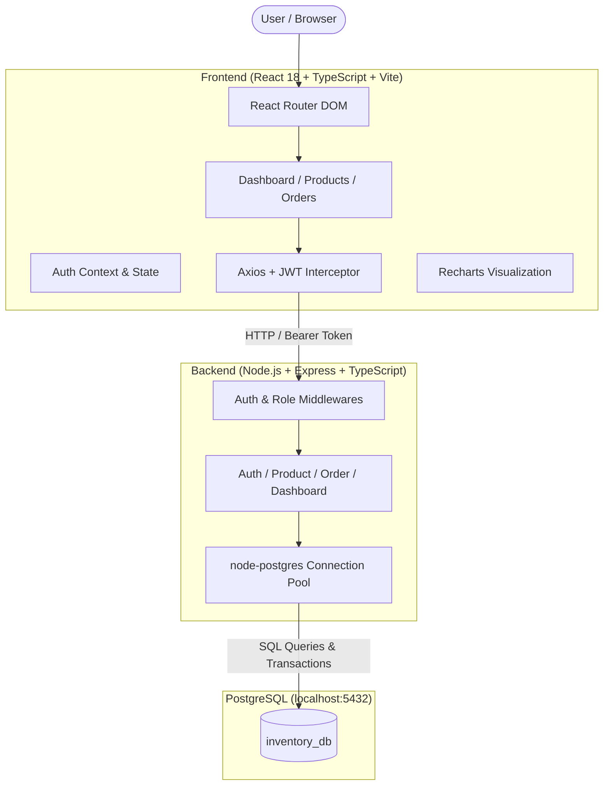

# 📦 StockFlow — Order & Inventory Management Dashboard

> **Production-grade fullstack web application template built with React, TypeScript, Node.js, Express, and PostgreSQL.**  
> Designed specifically for small businesses, retail shops, and client contract templates with a high-end UI/UX experience.

---

## 🌟 Key Highlights & Client Value

- **🔐 Dual-Role Authentication (JWT)**: Complete access separation between **Admin** (unrestricted access, inventory deletion, user audits) and **Staff** (order entry, inventory modification, status transitions).
- **📦 Smart Inventory Management**: Full CRUD capabilities, real-time SKU tracking, dynamic category filtering, search, and **automated Low-Stock Warning alerts**.
- **🛒 Order Workflow Automation**: Multi-item order creation with **atomic stock validation** and transactional deductions, plus a strict order lifecycle flow: `new` ➔ `paid` ➔ `delivered`.
- **📊 Real-Time Analytics Dashboard**: Daily sales trend visualization, top-performing products by revenue/units sold, KPI statistics cards, and instant low-stock warning banners.
- **🎨 Elevated UI/UX Experience**: Built using modern design system principles—clean typography (`Plus Jakarta Sans`), subtle micro-interactions, responsive sidebars, badge status indicators, and modal workflows.

---

## 🏗️ System Architecture



---

## 📂 Project Directory Structure

```text
inventery/
├── .gitignore                   # Comprehensive git exclusions
├── .env.example                 # Root unified environment variable template
├── package.json                 # Monorepo/Workspace helper scripts
├── README.md                    # Project documentation & setup guide
│
├── backend/                     # Node.js + Express + TypeScript Backend
│   ├── .env.example             # Backend environment template
│   ├── package.json             # Backend dependencies and scripts
│   ├── tsconfig.json            # Backend TypeScript compiler config
│   └── src/
│       ├── config/
│       │   ├── db.ts            # PostgreSQL pool connection (host: localhost, pwd: 1234)
│       │   └── env.ts           # Type-safe environment variable mappings
│       ├── controllers/
│       │   ├── auth.controller.ts        # Login & user validation
│       │   ├── product.controller.ts     # CRUD, search & low stock alerts
│       │   ├── order.controller.ts       # Order creation & status lifecycle
│       │   └── dashboard.controller.ts   # Daily sales & top products metrics
│       ├── db/
│       │   ├── schema.sql       # PostgreSQL DDL tables & indexes
│       │   └── initDb.ts        # Automatic database migration & seeder script
│       ├── middlewares/
│       │   ├── auth.middleware.ts        # Bearer token verification
│       │   ├── role.middleware.ts        # RBAC (admin vs staff gatekeeper)
│       │   └── error.middleware.ts       # Centralized error handler
│       ├── routes/
│       │   ├── auth.routes.ts
│       │   ├── product.routes.ts
│       │   ├── order.routes.ts
│       │   ├── dashboard.routes.ts
│       │   └── index.ts         # Consolidated router aggregator
│       ├── types/
│       │   └── index.ts         # Shared backend TypeScript types
│       ├── utils/
│       │   ├── jwt.ts           # Token sign & verify utilities
│       │   └── logger.ts        # Standardized console logger
│       ├── app.ts               # Express application configuration
│       └── server.ts            # HTTP server bootstrap entry point
│
└── frontend/                    # React + TypeScript + Vite Frontend
    ├── .env.example             # Frontend environment template
    ├── index.html               # Main HTML entry with Plus Jakarta Sans typography
    ├── package.json             # Frontend dependencies (Recharts, Lucide, Tailwind)
    ├── postcss.config.js        # PostCSS configuration
    ├── tailwind.config.js       # Modern design system theme colors
    ├── tsconfig.json            # React TypeScript compiler config
    ├── tsconfig.node.json       # Vite tooling TypeScript config
    ├── vite.config.ts           # Vite development server settings
    └── src/
        ├── components/
        │   ├── common/
        │   │   ├── Badge.tsx            # Contextual status badges
        │   │   ├── Button.tsx           # Button with loading states & variants
        │   │   ├── Card.tsx             # Polished dashboard cards
        │   │   ├── Input.tsx            # Form inputs with helper & error text
        │   │   ├── LoadingSpinner.tsx   # Loading indicator
        │   │   └── Modal.tsx            # Accessible dialog modal
        │   └── layout/
        │       ├── Layout.tsx           # Master layout wrapper
        │       ├── Navbar.tsx           # Top navigation with user role pill
        │       ├── ProtectedRoute.tsx   # JWT session and role guard
        │       └── Sidebar.tsx          # Navigation sidebar with active state
        ├── context/
        │   └── AuthContext.tsx          # Authentication & persistent session context
        ├── hooks/
        │   └── useAuth.ts               # Convenient Auth hook
        ├── pages/
        │   ├── DashboardPage.tsx        # KPI metrics & Recharts sales bar chart
        │   ├── LoginPage.tsx            # Modern sign-in with 1-click test credentials
        │   ├── OrdersPage.tsx           # Order catalog & status workflow stepper
        │   ├── ProductsPage.tsx         # Inventory table, search & stock editor
        │   └── NotFoundPage.tsx         # 404 handler
        ├── services/
        │   └── api.ts                   # Axios instance with auto-bearer injection
        ├── types/
        │   └── index.ts                 # Frontend TypeScript interfaces
        ├── App.tsx                      # Application routing & providers
        ├── main.tsx                     # React DOM mount point
        └── index.css                    # Tailwind CSS directives & global scrollbar
```

---

## ⚙️ Environment Variables Reference

### Backend (`backend/.env`)

| Variable | Default Value | Description |
| :--- | :--- | :--- |
| `PORT` | `5000` | Port on which Express API server listens |
| `NODE_ENV` | `development` | Runtime environment mode |
| `DB_HOST` | `localhost` | PostgreSQL host |
| `DB_PORT` | `5432` | PostgreSQL port |
| `DB_USER` | `postgres` | PostgreSQL superuser/app user |
| `DB_PASSWORD` | `1234` | PostgreSQL user password |
| `DB_NAME` | `inventory_db` | Target database name |
| `JWT_SECRET` | `super_secret_jwt_key...` | Cryptographic secret for signing tokens |
| `JWT_EXPIRES_IN` | `7d` | Token expiration duration |
| `CORS_ORIGIN` | `http://localhost:5173` | Allowed frontend origin for CORS |

### Frontend (`frontend/.env`)

| Variable | Default Value | Description |
| :--- | :--- | :--- |
| `VITE_API_BASE_URL` | `http://localhost:5000/api` | Base HTTP endpoint for the backend API |

---

## 👥 Role Permissions Matrix

| Feature | Admin Role | Staff Role | Customer Role |
| :--- | :---: | :---: | :---: |
| View Dashboard & Analytics | ✅ Full | ✅ Full | ❌ Restricted |
| View Products Catalog & Stock | ✅ Full | ✅ Full | ✅ Shop & Order |
| Create / Edit Products | ✅ Full | ✅ Full | ❌ Restricted |
| **Delete Products** | ✅ **Allowed** | ❌ **Forbidden (403)** | ❌ Restricted |
| Place Orders & Select Payment (Telebirr/CBE) | ✅ Allowed | ✅ Allowed | ✅ Self-Service Portal |
| Submit Payment Transaction Reference | ✅ Allowed | ✅ Allowed | ✅ Allowed |
| **Verify Customer Payment** | ✅ **Allowed** | ✅ **Allowed** | ❌ Restricted |
| Update Order Status (`new` ➔ `paid` ➔ `delivered`) | ✅ Full | ✅ Full | ❌ View Only |

---

## 🇪🇹 Ethiopian Payment Integration (Telebirr, CBEBirr, CBE Bank)

1. **Telebirr SuperApp**:
   - Customers transfer funds to merchant phone number (`0911-23-45-67`).
   - Customer submits the SMS confirmation transaction reference ID.
2. **CBEBirr Mobile Money**:
   - Customers transfer funds to merchant CBEBirr account (`0922-34-56-78`).
   - Customer submits the CBEBirr transaction code.
3. **Commercial Bank of Ethiopia (CBE Bank Transfer)**:
   - Direct bank transfer or mobile banking transfer to CBE Account (`1000-1234-5678-9`).
   - Customer submits the bank reference number (e.g. `FT...`).
4. **Staff Verification Workflow**:
   - Orders with submitted references appear with status **`Pending Payment Verification`**.
   - Staff/Admin clicks **"Verify Payment"** in the order dashboard to confirm the funds.
   - Verification marks payment status as **`Verified`** and automatically transitions the order to **`Paid`**!

---

## 🔑 Default Test Credentials (3 Roles)

The database initialization script automatically provisions ready-to-test accounts for all three roles:

| Role | Email | Password | Access Scope |
| :--- | :--- | :--- | :--- |
| **Admin** | `admin@business.com` (or `admin@gmail.com`) | `admin123` | Full admin privileges (inventory deletion, metrics, verification) |
| **Staff** | `staff@business.com` (or `staff@gmail.com`) | `staff123` | Operations, order fulfillment, Telebirr/CBE payment verification |
| **Customer** | `customer@business.com` (or `customer@gmail.com`) | `customer123` | Self-service store catalog, order placement, reference submission |

*(The login page provides 1-click credential autofill buttons for each of the three accounts.)*

---

## 🚀 Quick Start Guide

### 1. Prerequisites
- **Node.js**: v18.0.0 or higher (v20+ recommended)
- **PostgreSQL**: Installed and running locally on port `5432` with password `1234`

### 2. Configure Environment Files
In `backend/`:
```bash
cp .env.example .env
```
In `frontend/`:
```bash
cp .env.example .env
```

### 3. Install Dependencies
Install all packages from the project root:
```bash
npm run install:all
```
*(Or navigate to `backend` and `frontend` separately and run `npm install`)*

### 4. Initialize Database & Seed Sample Data
Ensure PostgreSQL is active, then execute:
```bash
npm run db:init
```
This will:
1. Connect to PostgreSQL and create the `inventory_db` database if it doesn't already exist.
2. Execute `schema.sql` to generate `users`, `products`, `orders`, and `order_items` tables with proper indexes.
3. Seed default admin, staff, and initial inventory products (including low-stock sample items).

### 5. Start Development Servers

**Terminal 1 — Backend API:**
```bash
npm run dev:backend
# API starts at http://localhost:5000 (Health check: http://localhost:5000/health)
```

**Terminal 2 — Frontend App:**
```bash
npm run dev:frontend
# App starts at http://localhost:5173
```

---

## 📡 Core API Endpoints

### 🔐 Authentication
- `POST /api/auth/login` — Authenticate user and receive JWT bearer token
- `GET /api/auth/me` — Retrieve active user session profile *(Auth required)*

### 📦 Products & Inventory
- `GET /api/products` — List all products with optional `?search=` and `?category=`
- `GET /api/products/low-stock` — Retrieve products with stock at or below low-stock threshold
- `GET /api/products/:id` — Get product detail by ID
- `POST /api/products` — Add a new product to inventory *(Auth required)*
- `PUT /api/products/:id` — Update product details or stock *(Auth required)*
- `DELETE /api/products/:id` — Delete a product *(Admin role only)*

### 🛒 Orders
- `GET /api/orders` — List orders with item details and status
- `POST /api/orders` — Create new order (validates stock, deducts inventory, creates line items)
- `PATCH /api/orders/:id/status` — Update order status (`new`, `paid`, `delivered`)

### 📊 Dashboard & Metrics
- `GET /api/dashboard/summary` — Aggregated KPI metrics, sales revenue per day, and top products

---

## 💡 Client Hand-off Ready
This codebase is organized following clean architectural patterns—separation of concerns, typed interfaces on both client and server, modular reusable components, and standard PostgreSQL connection pooling. It is ready for client demonstrations and further feature scaling!

